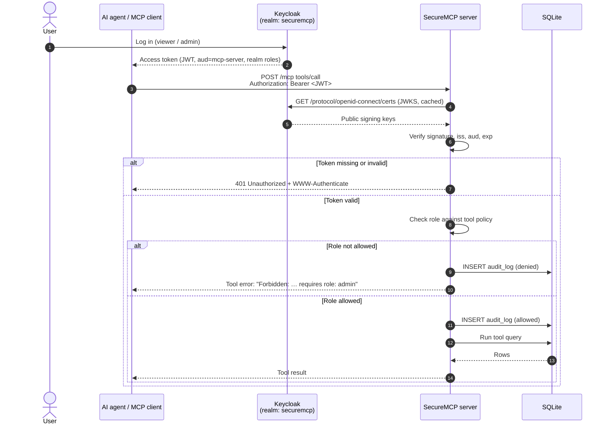
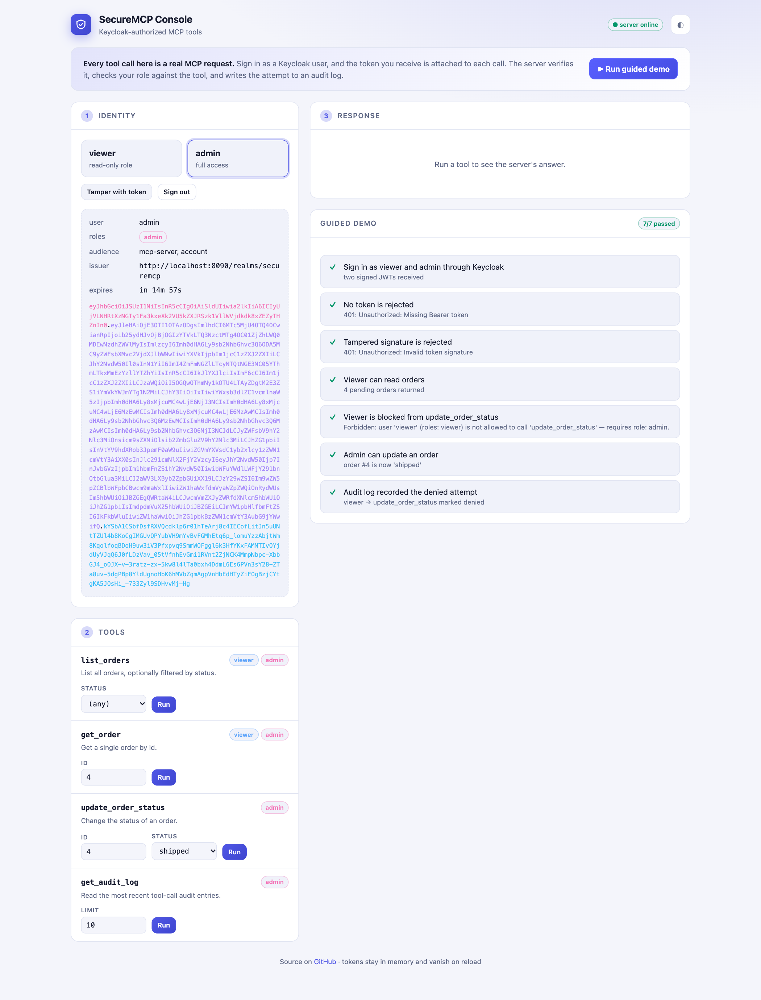
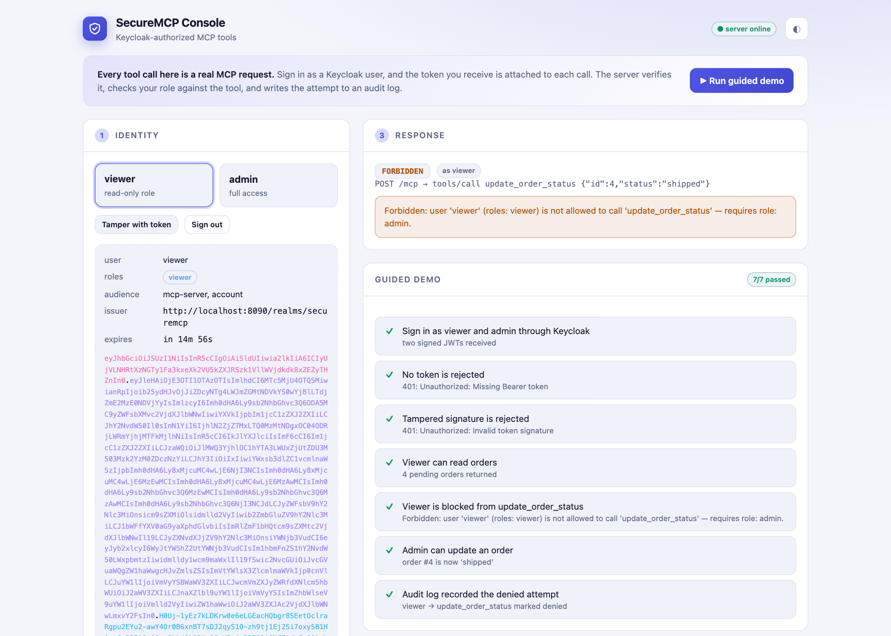
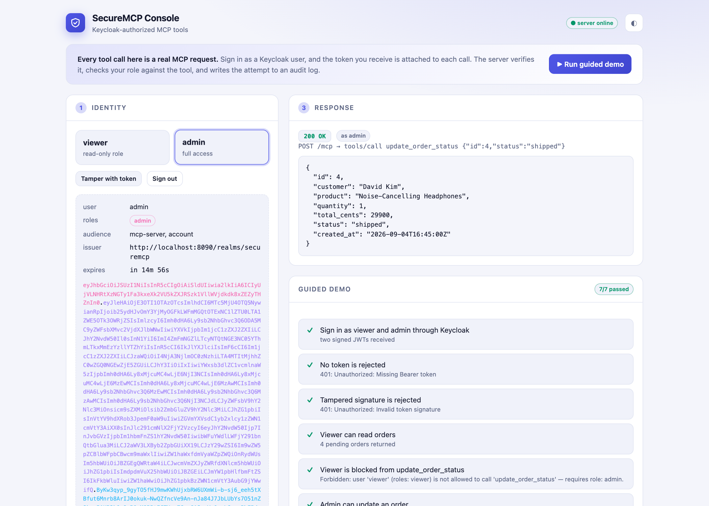
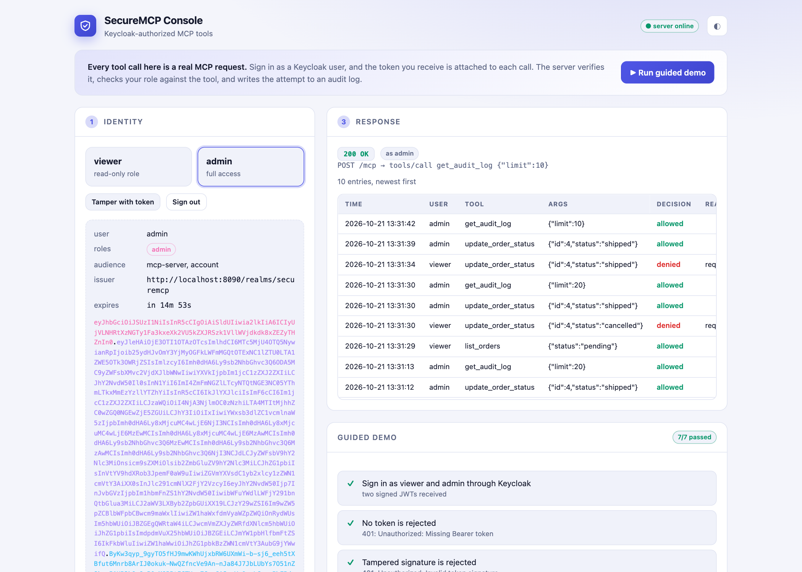

# SecureMCP

An [MCP (Model Context Protocol)](https://modelcontextprotocol.io) server where **every tool call is authenticated and authorized by Keycloak**.

AI agents are getting direct access to business data through MCP tools. SecureMCP shows how to put a real identity provider in front of that access: the agent must present a Keycloak-issued JWT, each tool is gated by a role, and every attempt — allowed or denied — is written to an audit log.


**Stack:** Node.js · TypeScript · `@modelcontextprotocol/sdk` (Streamable HTTP) · Keycloak · `jose` · SQLite (`better-sqlite3`) · Vitest · Docker Compose

---

## Features

- 🔐 **No token, no access.** Every request to `/mcp` must carry a valid `Authorization: Bearer <jwt>`. Signature (RS256 via Keycloak's JWKS), issuer, audience and expiry are all verified; otherwise the server answers `401` with a `WWW-Authenticate` header.
- 🧑‍⚖️ **Role-based tools.** Realm roles from the token (`realm_access.roles`) decide which tools a caller may use.
- 🚫 **Clear `Forbidden` errors.** A disallowed call returns an MCP tool error the agent can read, e.g.
  `Forbidden: user 'viewer' (roles: viewer) is not allowed to call 'update_order_status' — requires role: admin.`
- 📜 **Audit trail.** Every tool call is stored in `audit_log` (user, tool, args, allowed/denied, reason, timestamp) and is readable by admins through a tool.
- 🖥️ **Demo console.** A small web page at `/` lets you sign in as `viewer` or `admin`, inspect the decoded JWT, run every tool, and watch the server allow or refuse. A **guided demo** button runs the full test flow in one click.
- 🔁 **Stateless.** Each HTTP request gets a fresh MCP server instance, so every request is re-authenticated — no session can outlive its token.

### Tools

| Tool | Arguments | `viewer` | `admin` |
| --- | --- | :---: | :---: |
| `list_orders` | `status?` | ✅ | ✅ |
| `get_order` | `id` | ✅ | ✅ |
| `update_order_status` | `id`, `status` | ❌ | ✅ |
| `get_audit_log` | `limit?` (default 50) | ❌ | ✅ |

Order statuses: `pending`, `paid`, `shipped`, `delivered`, `cancelled`. The database is seeded with 20 orders on first start.

---

## Auth flow



---

## Project structure

```
SecureMCP/
├── src/
│   ├── index.ts          # Entry point: config → DB → HTTP server
│   ├── app.ts            # Express app, /mcp endpoint (stateless Streamable HTTP)
│   ├── auth.ts           # Bearer-token middleware, JWT verification with jose
│   ├── policy.ts         # Role policy: which roles may call which tool
│   ├── tools.ts          # Tool definitions, authorization + audit wrapper
│   ├── db.ts             # SQLite connection, schema, first-run seeding
│   ├── orders.ts         # Order types and queries
│   ├── audit.ts          # Audit log types, write and read
│   ├── seed.ts           # Demo orders
│   ├── jsonrpc.ts        # JSON-RPC error body helper
│   └── config.ts         # Environment configuration (only place that reads env)
├── public/
│   └── index.html        # Demo console (single static page, no build step)
├── tests/                # Vitest suites (local JWKS, no Keycloak needed)
├── keycloak/
│   └── realm-export.json # Auto-imported realm: client, roles, test users
├── scripts/
│   └── get-token.sh      # Fetch a token for a test user
├── docker-compose.yml    # Keycloak + MCP server
├── Dockerfile
└── .env.example
```

---

## Getting started

### Prerequisites

- Docker + Docker Compose
- Node.js 22+ (only to run locally outside Docker or to run the tests)
- `curl`

### 1. Start everything

```bash
git clone https://github.com/okba-bouziane/SecureMCP.git
cd SecureMCP
docker compose up --build
```

This starts:

| Service | URL | Notes |
| --- | --- | --- |
| Keycloak | http://localhost:8080 | Admin console login: `kcadmin` / `kcadmin` |
| SecureMCP | http://localhost:3000/mcp | Waits until Keycloak is healthy |

The `securemcp` realm is imported automatically with:

- client **`mcp-server`** (public, with an audience mapper so tokens carry `aud: mcp-server`)
- realm roles **`viewer`** and **`admin`**
- users **`viewer` / `viewer`** and **`admin` / `admin`**

> Port 3000 already in use? Run `MCP_PORT=3100 docker compose up --build`.

### 2. Open the console

Browse to **http://localhost:3000** (or your `MCP_PORT`), pick a user, run tools, or press **▶ Run guided demo**.

Prefer the command line? Continue with the steps below.

### 3. Get a token

```bash
TOKEN=$(./scripts/get-token.sh viewer)   # or: ./scripts/get-token.sh admin
```

Tokens are valid for 15 minutes.

### 4. Call a tool

```bash
curl -s http://localhost:3000/mcp \
  -H "Authorization: Bearer $TOKEN" \
  -H "Content-Type: application/json" \
  -H "Accept: application/json, text/event-stream" \
  -d '{"jsonrpc":"2.0","id":1,"method":"tools/call","params":{"name":"get_order","arguments":{"id":1}}}'
```

Try the same call without the header (→ `401`), or call `update_order_status` with the viewer token (→ `Forbidden`).

### Run the server without Docker

```bash
docker compose up -d keycloak
cp .env.example .env
npm install
npm run build
node --env-file=.env dist/index.js
```

---

## Connect an MCP client

### MCP Inspector

```bash
npx @modelcontextprotocol/inspector
```

1. **Transport type:** `Streamable HTTP`
2. **URL:** `http://localhost:3000/mcp`
3. **Authentication:** header `Authorization`, value `Bearer <paste output of ./scripts/get-token.sh admin>`
4. Click **Connect**, open **Tools → List Tools**, and run them.

Use a viewer token to see the `Forbidden` responses.

### Claude Desktop

Claude Desktop launches local MCP servers over stdio, so use [`mcp-remote`](https://www.npmjs.com/package/mcp-remote) as a bridge that adds the Bearer header. Edit `claude_desktop_config.json`
(macOS: `~/Library/Application Support/Claude/`, Windows: `%APPDATA%\Claude\`):

```json
{
  "mcpServers": {
    "securemcp": {
      "command": "npx",
      "args": [
        "-y",
        "mcp-remote",
        "http://localhost:3000/mcp",
        "--header",
        "Authorization:${AUTH_HEADER}"
      ],
      "env": {
        "AUTH_HEADER": "Bearer <paste output of ./scripts/get-token.sh admin>"
      }
    }
  }
}
```

Restart Claude Desktop, then ask something like *"List the pending orders and mark order 4 as shipped."* Tokens expire after 15 minutes — fetch a new one and restart when that happens.

---

## Screenshots

| | |
| --- | --- |
| **Demo console — guided demo (7/7 checks)** |  |
| **Viewer blocked from `update_order_status`** |  |
| **Admin updating an order** |  |
| **`get_audit_log` output** |  |

---

## Tests

```bash
npm install
npm test
```

The test suite starts the real Express app on a random port and signs tokens with a locally generated RSA key (served as an in-memory JWKS), so **no running Keycloak is needed**. It covers:

- ✅ valid token → tools are listed and callable
- 🚫 missing token / non-Bearer header → `401`
- ⌛ expired token → `401`
- 🔑 token signed by an untrusted key, wrong issuer, wrong audience, malformed token → `401`
- 🧑‍⚖️ viewer blocked from `update_order_status` and `get_audit_log` (order left unchanged)
- 📜 audit log records allowed and denied calls, readable via `get_audit_log`

---

## Configuration

| Variable | Default | Description |
| --- | --- | --- |
| `PORT` | `3000` | HTTP port |
| `HOST` | `0.0.0.0` | Bind address |
| `DB_PATH` | `./data/securemcp.db` | SQLite file (created and seeded on first start) |
| `KEYCLOAK_ISSUER` | `http://localhost:8080/realms/securemcp` | Expected `iss` claim |
| `KEYCLOAK_JWKS_URL` | `${KEYCLOAK_ISSUER}/protocol/openid-connect/certs` | Where signing keys are fetched |
| `KEYCLOAK_AUDIENCE` | `mcp-server` | Expected `aud` claim |
| `MCP_PORT` | `3000` | Host port published by Docker Compose |

In Docker, the server fetches keys from `http://keycloak:8080` on the internal network while still expecting `iss=http://localhost:8080/...`; Keycloak is pinned to that public hostname with `KC_HOSTNAME`.

---

## Security notes

This is a demo, not a production deployment:

- `scripts/get-token.sh` uses the **password grant** for convenience. Real agents should use Authorization Code + PKCE (the `mcp-server` client already allows it for the Inspector's redirect URI) or client credentials.
- Keycloak runs in `start-dev` mode over plain HTTP with default passwords. Use TLS, a real database and secret management in production.
- Tool arguments are stored verbatim in the audit log — redact sensitive fields if your tools accept them.

## License

[MIT](LICENSE)
